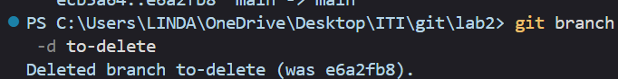
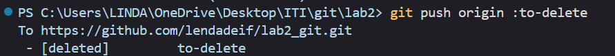
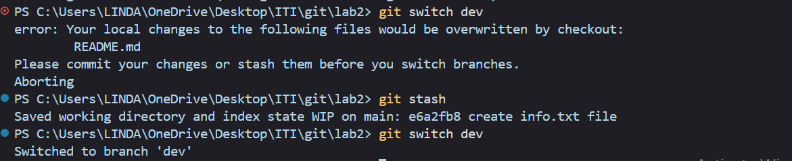
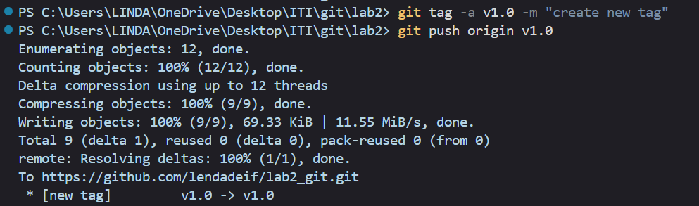
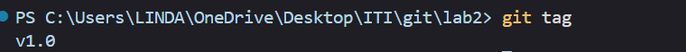

Lab 2 Git

## Questions:

1. Tell me how to remove them locally and remotely.

---

2. Tell me how to checkout another branch without commit changes

   1. git stash

   

---

3. Create an annotated tag with tagname (v1.7) .

---

4. Tell me how to list tags

---

5. Tell me how to delete tag locally and remotely.

